# Dental Clinic Management System

A web application for running a dental clinic: patient files, appointment booking, medical records, staff, services and billing, all in one place.

Built with **Laravel 12**, **Bootstrap 5** and **MySQL/MariaDB**.

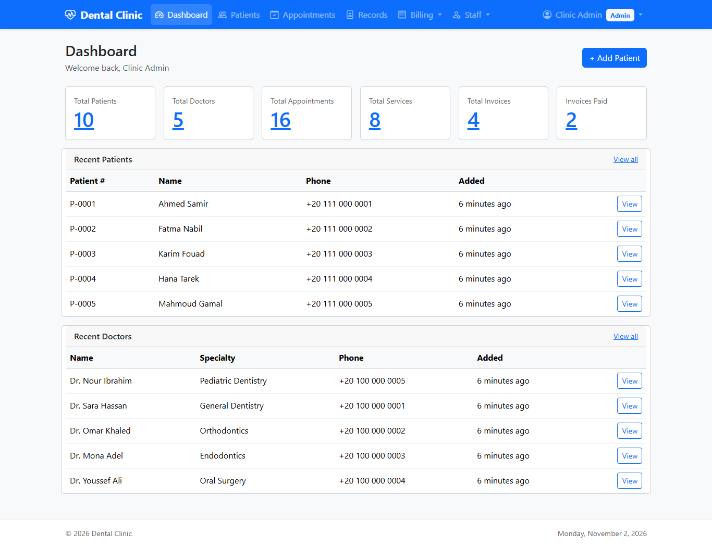

---

## Features

| Module | What it does |
|---|---|
| **Dashboard** | Totals for patients, doctors, appointments, services and invoices, plus the latest patients and doctors. |
| **Patients** | Patient files with contact details, date of birth, blood type, allergies, medical history and current medications. Each patient page also lists their medical records. |
| **Appointments** | Book a patient with a doctor for a service. Filter by date, doctor or status (pending, confirmed, completed, cancelled, no show). |
| **Medical Records** | A diagnosis, clinical notes and recommendations, written by a doctor and optionally linked to an appointment (one record per appointment). Searchable by patient or diagnosis. |
| **Invoices** | Invoices with line items per service, discounts and taxes. Status can be pending, paid, overdue or cancelled. |
| **Services** | The treatment catalogue, with codes and prices. Services can be switched on or off. |
| **Taxes** | Percentage or fixed taxes, attached to services. |
| **Staff** | Doctors (specialty, experience, profile), receptionists and user accounts, with roles and an active/inactive switch. |
| **Authentication** | Log in, password reset and profile management. |

### User roles

- **Admin**: manages the whole clinic.
- **Doctor**: can be booked for appointments and writes medical records.
- **Receptionist**: front-desk staff.

> **Note:** roles are stored and displayed, but pages are not yet restricted by role. Any logged-in user can open every module.

---

## Screenshots

| | |
|---|---|
| **Login**<br>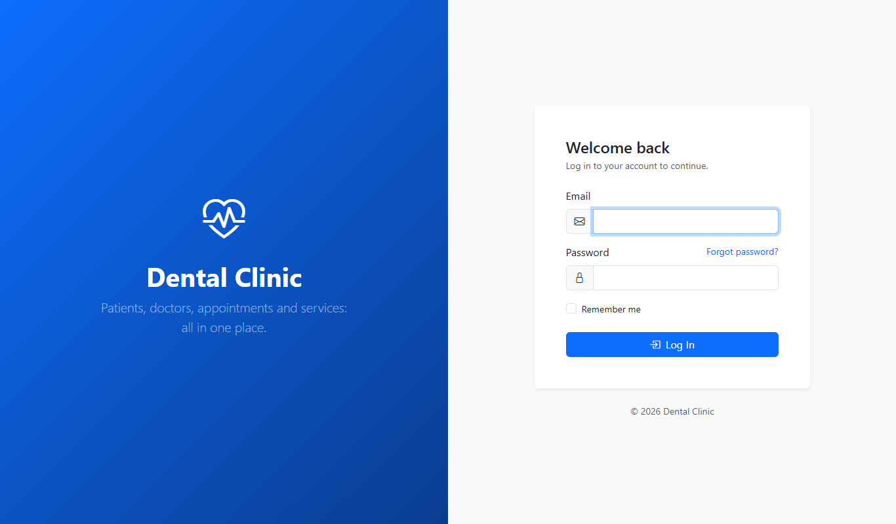 | **Dashboard**<br> |
| **Patients**<br>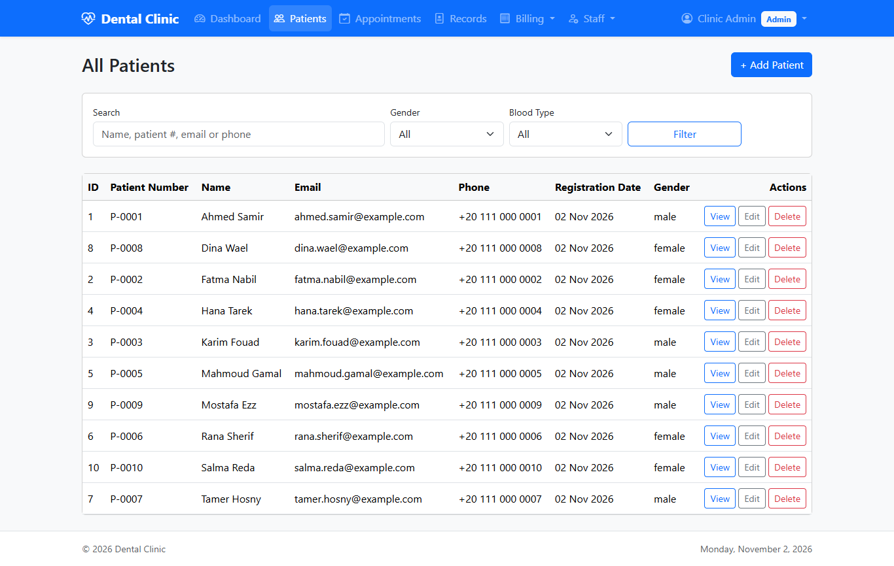 | **Patient profile**<br>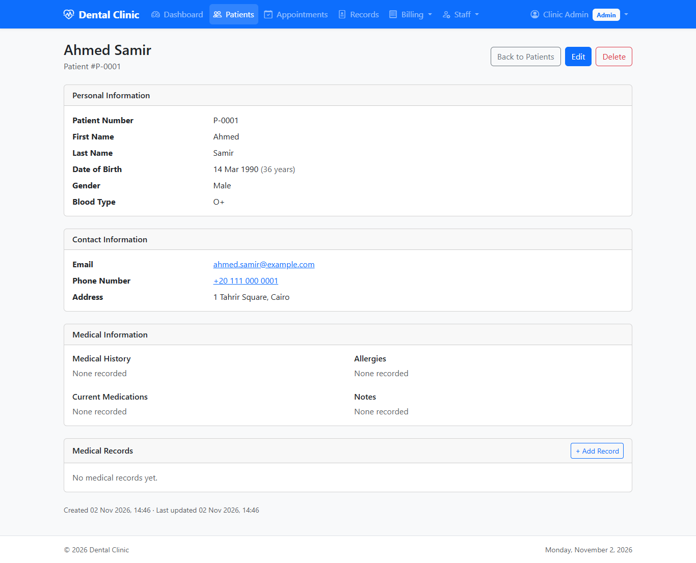 |
| **Appointments**<br>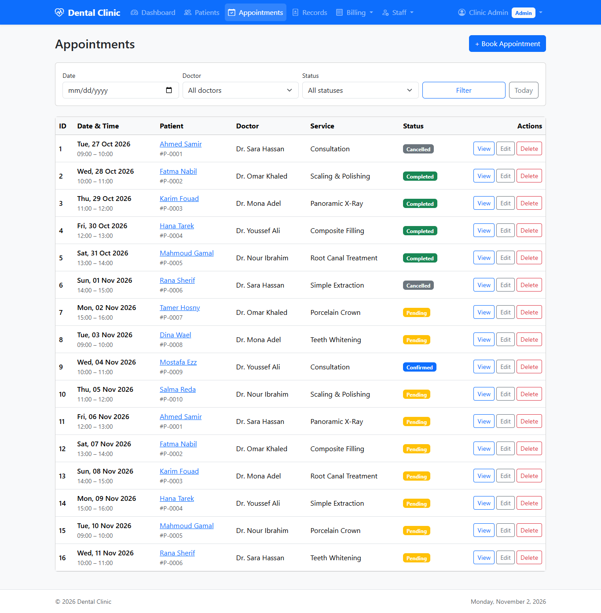 | **Appointment details**<br>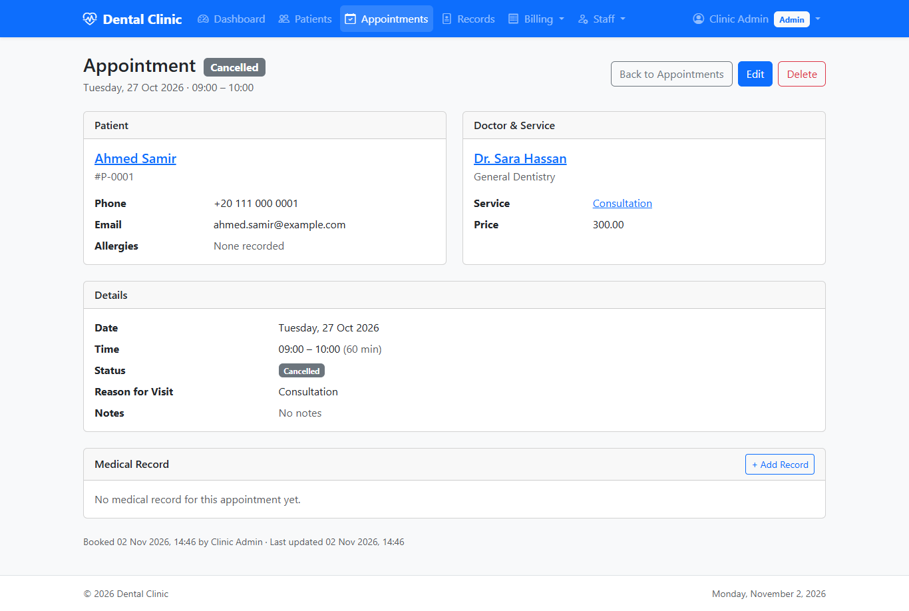 |
| **Book an appointment**<br>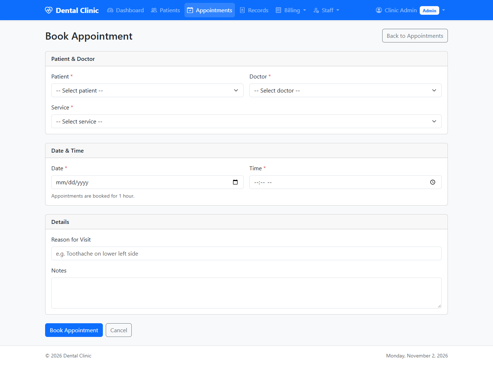 | **Medical records**<br>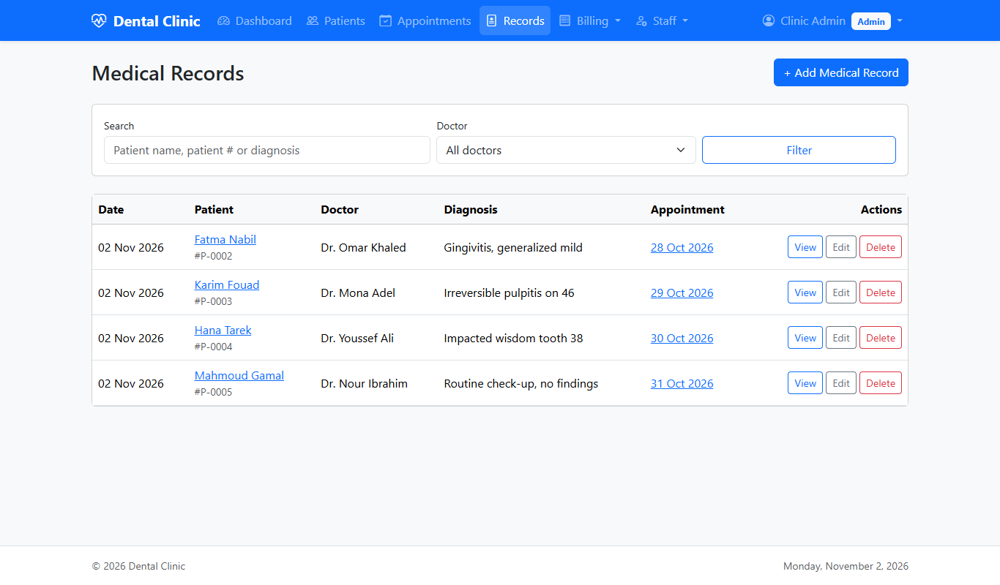 |
| **Medical record**<br>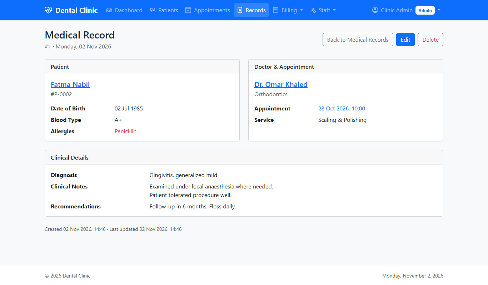 | **Invoices**<br>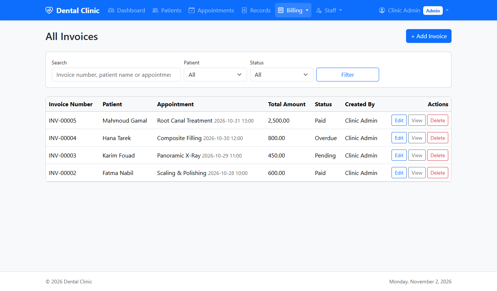 |
| **Invoice**<br>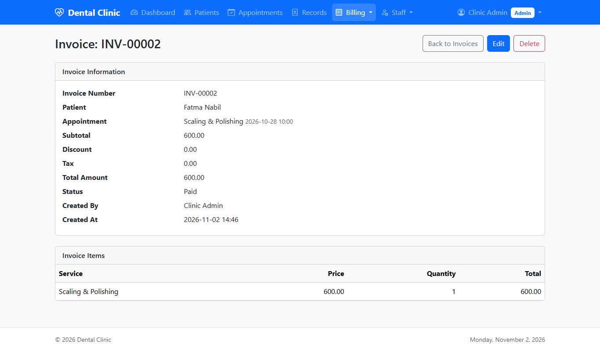 | **Services**<br>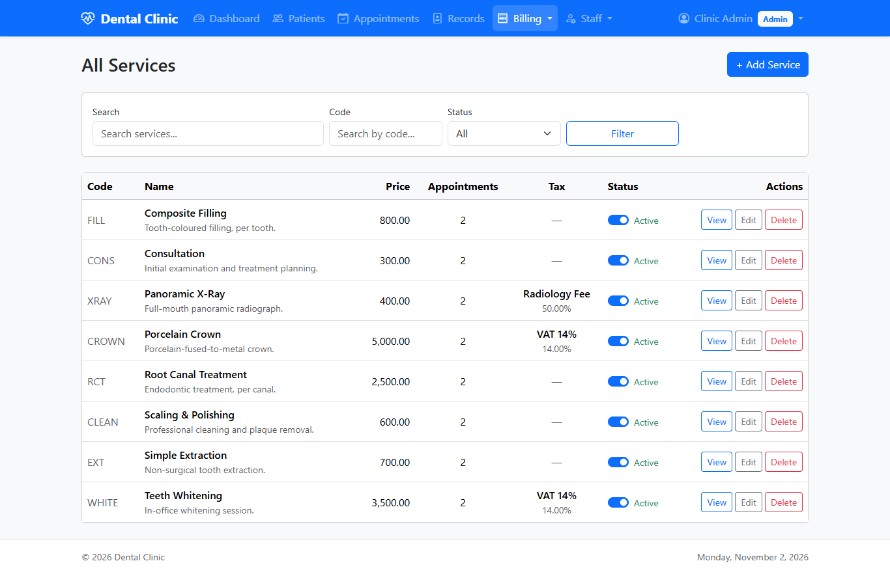 |
| **Doctors**<br>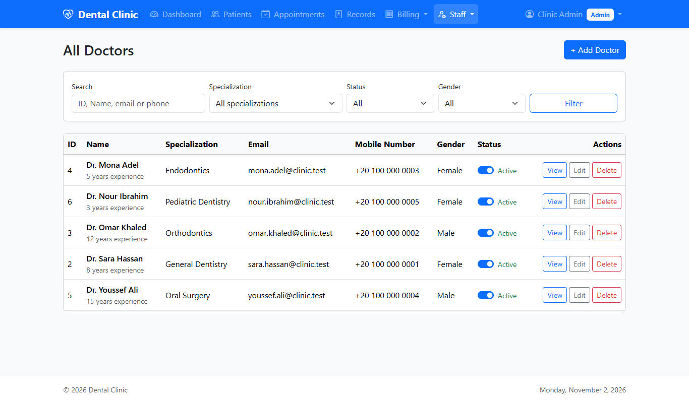 | **Staff menu**<br>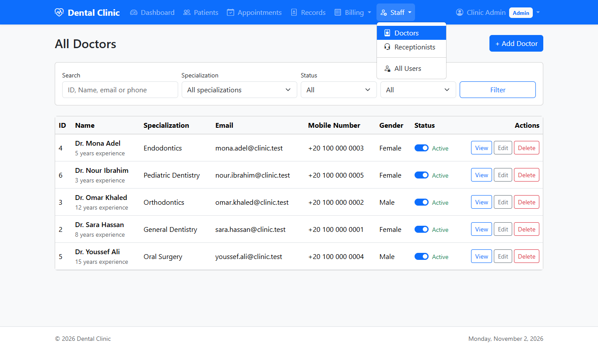 |

All names and data in the screenshots are made-up demo data.

---

## Tech stack

- **Backend:** PHP 8.2+, Laravel 12
- **Frontend:** Blade templates, Bootstrap 5.3, Bootstrap Icons (loaded from a CDN, so no build step is needed for the clinic pages)
- **Database:** MySQL or MariaDB
- **Auth:** Laravel Breeze

---

## Getting started

### Requirements

- PHP 8.2 or newer
- Composer
- MySQL or MariaDB (for example, through XAMPP)

### Installation

```bash
git clone https://github.com/miamen16/dental-clinic.git
cd dental-clinic

composer install
cp .env.example .env
php artisan key:generate
```

Create an empty database (for example `dental_clinic`), then set the connection in `.env`:

```env
DB_CONNECTION=mysql
DB_HOST=127.0.0.1
DB_PORT=3306
DB_DATABASE=dental_clinic
DB_USERNAME=root
DB_PASSWORD=
```

Create the tables and load the demo data:

```bash
php artisan migrate --seed
php artisan serve
```

Open http://127.0.0.1:8000.

### Demo accounts

All demo accounts use the password **`password`**.

| Role | Email |
|---|---|
| Admin | `admin@clinic.test` |
| Doctor | `sara.hassan@clinic.test` (and 4 more doctors) |
| Receptionist | `reception@clinic.test` |

The seeders also add 8 services, 3 taxes and 10 patients. You can run `php artisan db:seed` again safely; it won't create duplicates.

> Change or remove these accounts before putting the system online.

---

## Project structure

```
app/
  Http/Controllers/     One folder per module (Patients, Appointments, MedicalRecords, Invoices, ...)
  Http/Requests/        Form validation, one folder per module
  Models/               Eloquent models (Patient, Appointment, MedicalRecord, Invoice, Service, Tax, User, ...)
database/
  migrations/           Database schema
  seeders/              Demo data (users, services, taxes, patients)
resources/views/
  layouts/clinic.blade.php   Main layout and navigation bar
  <module>/                  index, create, edit and show pages for each module
routes/web.php          All application routes
docs/screenshots/       Screenshots used in this README
```

---

## Running tests

```bash
php artisan test
```

> `phpunit.xml` doesn't set its own database, so tests use the database in your `.env`. Point them at a separate test database before running anything that resets data.
